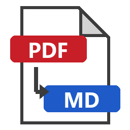
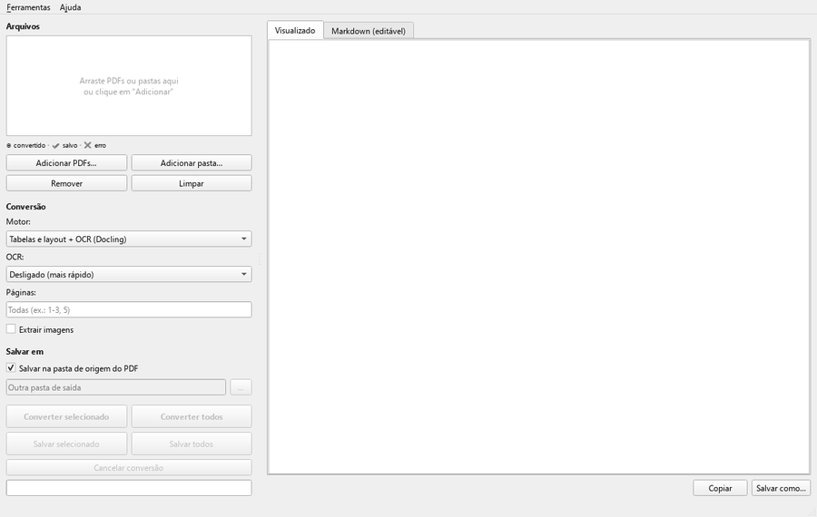
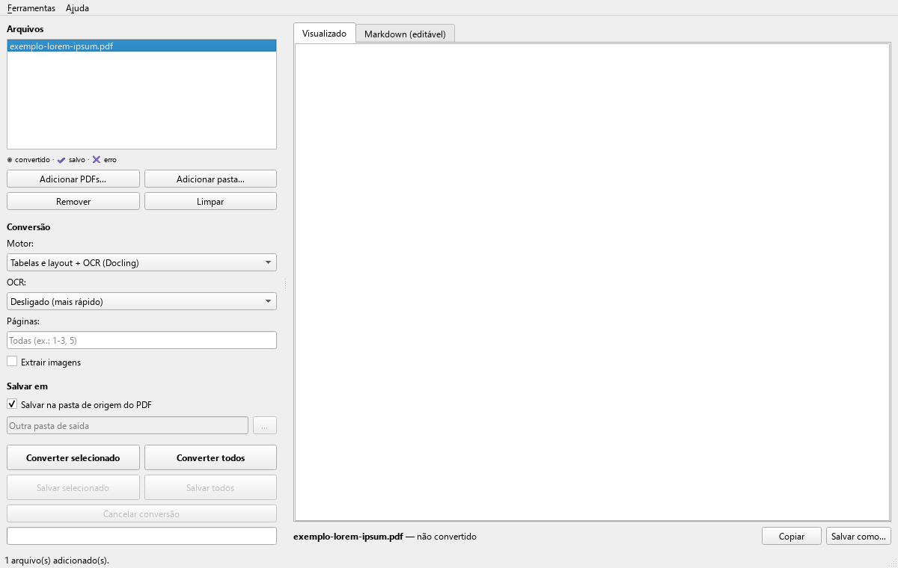
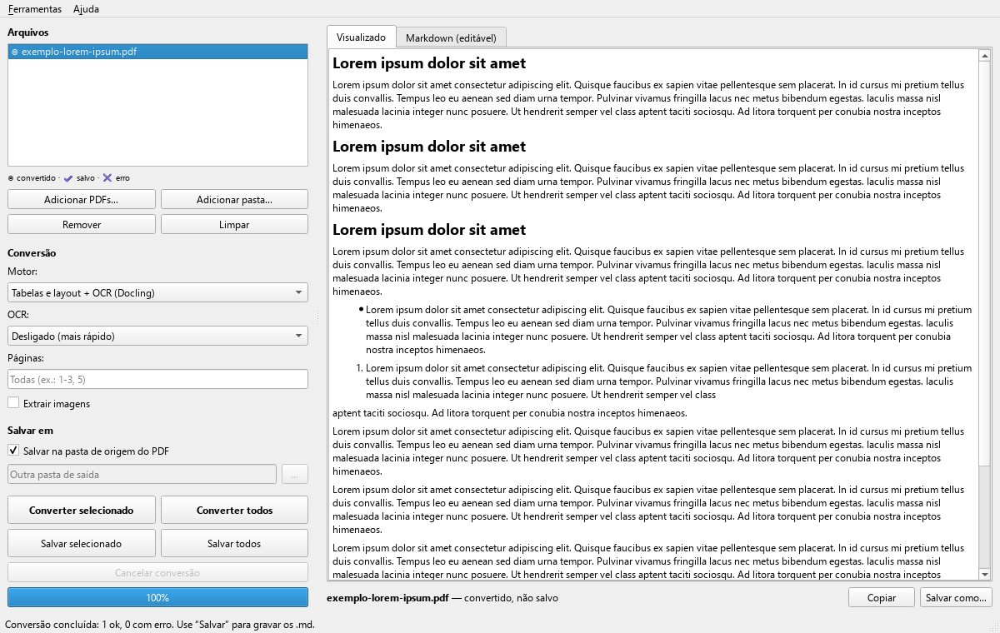
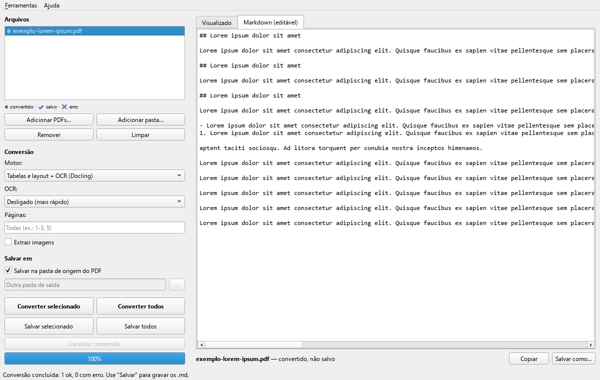

<div align="center">



# PDF2MD

**Converta PDFs em Markdown com uma interface gráfica. Sem linha de comando.**

[](https://github.com/BrunoBM88/pdf2md/releases/latest)


[](LICENSE)




[**⬇️ Baixar para Windows**](https://github.com/BrunoBM88/pdf2md/releases/latest) · [Como usar](#-como-usar) · [Perguntas frequentes](#-perguntas-frequentes)

</div>

---

## 👋 Por que este programa existe

Não sou programador. Trabalho com compras públicas e lido o dia inteiro com PDFs: autorizações de
fornecimento, notas fiscais, editais, termos de referência. Precisava passar esses documentos para
**Markdown**, um formato de texto simples que funciona muito bem com ferramentas de IA, wikis e
anotações, mas as ferramentas que encontrei (como o ótimo
[MarkItDown](https://github.com/microsoft/markitdown) da Microsoft) só funcionam pela **linha de comando**.

Então montei o PDF2MD: **uma janela onde você arrasta os PDFs, clica em converter e salva.** Ele foi
feito para resolver o meu problema, e estou publicando porque pode resolver o seu também.

*Bruno*

> [!NOTE]
> Como não sou desenvolvedor profissional, o código foi escrito com a ajuda de uma IA (Claude Code).
> Sugestões, correções e melhorias são muito bem-vindas. Veja [Como contribuir](CONTRIBUTING.md).

## ✨ Recursos

- 🖱️ **Arrastar e soltar** PDFs ou pastas inteiras, incluindo subpastas
- 👀 **Prévia lado a lado**: o Markdown formatado e o texto editável antes de salvar
- 📚 **Conversão em lote** com barra de progresso e botão de cancelar
- 📊 **Tabelas de verdade**: o motor Docling reconhece tabelas de itens, quantidades e valores
- 🔍 **OCR para PDFs escaneados**: lê documentos que são só imagem
- 📁 **Salva na mesma pasta do PDF** (ou em outra que você escolher)
- 🖱️ **Botão direito no Explorer**: "Converter para Markdown (PDF2MD)" em arquivos e pastas
- 🔒 **Tudo local**: nenhum documento sai do seu computador
- ⌨️ Modo linha de comando opcional, para quem quiser automatizar

## 🖼️ Capturas de tela

| Converter | Resultado formatado | Markdown editável |
|:---:|:---:|:---:|
|  |  |  |

<sub>As imagens usam um <a href="docs/exemplo/exemplo-lorem-ipsum.pdf">PDF de exemplo com texto Lorem ipsum</a>, sem nenhum dado real.</sub>

## ⬇️ Instalação

1. Baixe o arquivo **`PDF2MD-x.y.z-windows.zip`** na página de
   [Releases](https://github.com/BrunoBM88/pdf2md/releases/latest).
2. Descompacte e dê dois cliques em **`Instalar.bat`**.
3. Pronto: o PDF2MD aparece no **Menu Iniciar** e no **botão direito** dos PDFs.

Não precisa de administrador nem de Python instalado. Para remover, use
**Configurações → Aplicativos → Aplicativos instalados → PDF2MD**.

> [!IMPORTANT]
> - **Antivírus:** programas novos e sem assinatura digital costumam gerar alertas (Windows SmartScreen,
>   Kaspersky etc.). O código é aberto e pode ser conferido aqui. Se confiar, escolha "Permitir" ou "Executar assim mesmo".
> - **Primeira abertura lenta:** na primeira vez o antivírus examina os arquivos do programa, o que
>   pode levar um ou dois minutos. Depois disso o programa abre em cerca de 2 segundos.
> - **Tamanho:** cerca de 1 GB instalado, por causa dos modelos de IA usados para ler tabelas e fazer OCR.

## 🚀 Como usar

1. **Adicione os PDFs:** arraste para a janela, use os botões *Adicionar*, ou clique com o botão
   direito num PDF ou pasta no Explorer.
2. **Escolha o motor** (veja a tabela abaixo).
3. Clique em **Converter selecionado** ou **Converter todos**. O item fica com ◎ (convertido, ainda não salvo).
4. Confira a prévia. Se quiser, corrija o texto na aba *Markdown (editável)*.
5. Clique em **Salvar selecionado** ou **Salvar todos**. O `.md` vai para a pasta do PDF e o item fica com ✔.

### Qual motor escolher?

| Motor | Melhor para | Velocidade |
|---|---|---|
| ⚡ **Rápido** (PyMuPDF4LLM) | PDFs de texto comuns: ofícios, contratos, relatórios | segundos |
| 📊 **Tabelas e layout + OCR** (Docling) | AFs, notas fiscais, editais com tabelas, **PDFs escaneados** | ~1 a 2 min por arquivo |
| 📝 **Simples** (MarkItDown) | Só o texto, sem formatação | segundos |

**OCR** (só no Docling): *Automático* lê apenas as imagens dentro do PDF, *Forçar* lê todas as
páginas (use para documentos escaneados) e *Desligado* é o mais rápido.

> [!TIP]
> Se o motor rápido avisar que o PDF "parece escaneado", troque para o **Docling** com OCR em **Forçar**.

### Para quem gosta de linha de comando

```bat
PDF2MD.exe --cli arquivo1.pdf arquivo2.pdf --motor docling --ocr force --paginas 1-3 --saida C:\pasta
```

Grava os `.md` e um `pdf2md_cli.log` na pasta de saída.

## ❓ Perguntas frequentes

<details>
<summary><b>Meus documentos são enviados para a internet?</b></summary>

Não. A conversão acontece inteira no seu computador. A internet só é usada **uma vez**, na primeira
conversão com o Docling, para baixar os modelos de IA (algumas centenas de MB), que ficam guardados em
`%USERPROFILE%\.cache\huggingface`.
</details>

<details>
<summary><b>O item não aparece no botão direito do Windows 11</b></summary>

O Windows 11 esconde programas que não são da loja no menu novo. Clique em **Mostrar mais opções**
(ou use **Shift + F10**). Também dá para ligar e desligar o item em **Ferramentas → Mostrar no menu do botão direito**.
</details>

<details>
<summary><b>O OCR errou algumas letras</b></summary>

É normal em documentos escaneados com baixa qualidade, principalmente impressão matricial. Confira
sempre **números e valores** antes de usar o texto. Você pode corrigir direto na aba *Markdown (editável)* antes de salvar.
</details>

<details>
<summary><b>Funciona no Mac ou no Linux?</b></summary>

A versão pronta é só para Windows. O código usa bibliotecas multiplataforma, mas o instalador e o
menu de contexto são específicos do Windows. Contribuições são bem-vindas.
</details>

## 🧩 Créditos

O PDF2MD é uma interface gráfica sobre ferramentas excelentes de código aberto:

- [**PyMuPDF / PyMuPDF4LLM**](https://github.com/pymupdf/pymupdf4llm) (Artifex), o motor rápido
- [**Docling**](https://github.com/docling-project/docling) (IBM Research), tabelas, layout e OCR
- [**MarkItDown**](https://github.com/microsoft/markitdown) (Microsoft), o motor simples
- [**RapidOCR**](https://github.com/RapidAI/RapidOCR), o reconhecimento de texto em imagens
- [**Qt for Python (PySide6)**](https://doc.qt.io/qtforpython/), a interface gráfica

## 📄 Licença

[AGPL-3.0](LICENSE). Você pode usar, estudar, modificar e redistribuir. Se distribuir uma versão
modificada, ela também precisa ser aberta sob a mesma licença. (A AGPL é exigida pelo PyMuPDF, um dos motores usados.)

---

<div align="center">
<sub>Feito por Bruno para resolver um problema real de quem trabalha com PDFs todos os dias. Se for útil para você, deixe uma ⭐!</sub>
</div>

<details>
<summary>🇺🇸 English summary</summary>

**PDF2MD** is a Windows desktop app that converts PDF files to Markdown through a simple graphical
interface: drag and drop, preview, batch conversion, Explorer right-click integration, and three
engines (PyMuPDF4LLM, Docling with table recognition and OCR, and Microsoft MarkItDown). It was built
by a non-programmer, with AI assistance, to solve a day-to-day need without using the command line.
Everything runs locally. Download it from [Releases](https://github.com/BrunoBM88/pdf2md/releases/latest). Licensed under AGPL-3.0.
</details>
